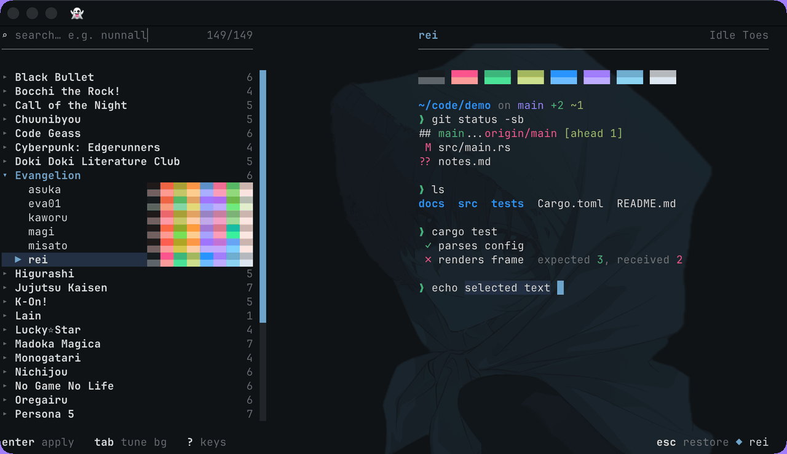

<h1 align="center">
  <picture>
    <source media="(prefers-color-scheme: light)" srcset="https://kecan0406.github.io/ttheme/readme/banner-light.png">
    
  </picture>
</h1>

<p align="center"><em>Character terminal palettes — readable by rule, switched live, one tab at a time.</em></p>

<p align="center">
  <a href="https://www.npmjs.com/package/@kecan0406/ttheme"></a>
  <a href="https://github.com/kecan0406/ttheme/actions/workflows/ci.yml"></a>
  <a href="https://ttheme.dev/"></a>
  <a href="LICENSE"></a>
</p>

<p align="center">
  <a href="https://ttheme.dev/">Site</a> ·
  <a href="https://ttheme.dev/docs">Docs</a> ·
  <a href="#palettes">Palettes</a> ·
  <a href="https://ttheme.dev/docs/reference/terminals">Terminals</a> ·
  <a href="CONTRIBUTING.md">Contributing</a>
</p>

<p align="center">
  
</p>

## Why ttheme

- **Colors from the character.** Every palette keeps the three colors that
  identify its character and borrows its ANSI ramp from an established scheme,
  harmonized so every official palette reads alike.
- **Every palette passes an accessibility gate.** Body text at 7:1 against the
  background (WCAG AAA), every meaningful ANSI color at 4.5:1 (WCAG AA), and each
  accent stays in its role — red reads as an error, green as success — and apart
  from its neighbors at text size, red and green too for a deuteranope. The build
  fails if a palette regresses. Why each threshold sits where it does:
  [the contrast checks](https://ttheme.dev/docs/reference/contrast-gate).
- **Switched live, per tab.** Tabs in one window can wear different palettes,
  any tab can be repainted at any time, a directory can pin its own, and a new
  tab can take the next character.

## Quick start

```sh
npx @kecan0406/ttheme@latest init
```

It needs Node 22 or newer and zsh, which macOS ships — bash and fish get the
`ttheme` command too, run through zsh. It asks which terminals to wire and which
catalogs to install, shows every file it is about to change, and writes nothing
until you confirm. Then:

```sh
exec zsh               # the ttheme command in this tab
ttheme                 # preview and browse as tabs — tab switches
```

ttheme adds one guarded line to each config it wires, sets colors only, and
`npx @kecan0406/ttheme@latest uninstall` takes it all back out:
[what changed, and how to undo it](https://ttheme.dev/docs/getting-started/what-changed).
The [docs](https://ttheme.dev/docs) start from
[install](https://ttheme.dev/docs/getting-started/install) and
[your first palette](https://ttheme.dev/docs/getting-started/first-palette).

## Palettes

<p align="center">
  <a href="https://ttheme.dev/"></a>
</p>

<details>
<summary><b>Every palette</b></summary>
<br>

</details>

Both images are drawn from the official marketplace as it ships, so they always
match what Browse offers. Every palette comes in a light and a dark mode, and
`ttheme light`, `ttheme dark` or `ttheme auto` picks the one they are all worn in
([light, dark and auto](https://ttheme.dev/docs/usage/modes)). Browse, the second
tab of `ttheme`, adds or drops single palettes any time, and a merged palette
reaches everyone with the next release.

Anyone can publish palettes from a GitHub repository as a marketplace, named
`<owner>@<name>`:

```sh
ttheme marketplace add alice/ttheme-pastel   # add alice's marketplace
ttheme add alice@pastel/dusk                 # and install one of its palettes
```

Nobody reviews a marketplace. Its palettes are colors and post numbers, never
code, and only the official marketplace is held to the contrast checks.
[The marketplaces page](https://ttheme.dev/marketplace) lists the public ones, and
[add and update palettes](https://ttheme.dev/docs/usage/palettes) covers the rest.

### Your own palettes

```sh
ttheme new rei      # the palette editor, on a blank palette
ttheme edit miku    # any palette; one that is not yours keeps your changes as a tone
ttheme share rei    # a link that carries the palette, or a marketplace on GitHub
```

The editor grows twenty colors that pass the gate from a few seeds, then tunes
each one in OKLCH while a mock terminal shows the result. The same builder runs
in a browser at [ttheme.dev/builder](https://ttheme.dev/builder), and a coding
agent with the ttheme-palette skill (`npx skills add kecan0406/ttheme`, or
`init` adds it) makes a palette from a character's official art.
[Your own palette](https://ttheme.dev/docs/creating-palettes/your-own),
[share a link](https://ttheme.dev/docs/creating-palettes/share) and
[publish a marketplace](https://ttheme.dev/docs/creating-palettes/publish) walk
through each.

## Usage

| Command | |
|---|---|
| `ttheme` | Preview and Browse as tabs of one screen — the tab repaints as the cursor moves, `enter` applies |
| `ttheme use <palette>` | Paint this tab (a unique prefix works) |
| `ttheme default <palette>` | The palette new tabs open with |
| `ttheme pin` / `unpin` / `pins` | A palette for a directory, its repository or an ssh host — `cd` or `ssh` in repaints, leaving restores |
| `ttheme auto` / `light` / `dark` | The mode every palette is worn in |
| `ttheme on` / `off` | Wear the default again / give the terminal its own colors back |
| `ttheme config` | Settings in `$EDITOR` |

`ttheme help` lists the everyday commands by task, and `ttheme help all` every
one with its options. [Commands](https://ttheme.dev/docs/reference/commands),
[settings](https://ttheme.dev/docs/reference/settings) and
[keys](https://ttheme.dev/docs/reference/keys) list them all.

## Terminal support

| | Ghostty | iTerm2 | kitty | Alacritty | WezTerm | Windows Terminal | Warp | Konsole | Terminal.app | Rio |
|---|:---:|:---:|:---:|:---:|:---:|:---:|:---:|:---:|:---:|:---:|
| **Setup with `init`** | ✅ | ✅ | ✅ | ✅ | ✅ | ✅ | ✅ | ✅ | ✅ | ✅ |
| **A palette per tab** | ✅ | ✅ | ✅ | ✅ | ✅ | ✅ | ✅ | ✅ | ✅ | ✅ |
| **Background pictures** | ✅ | ✅ | ✅ | — | ✅ | — | ✅ | ✅ | ✅ | — |
| **Follows the system's appearance** | ✅ | ✅ | ✅ | — | ✅ | — | — | — | — | — |

Nothing is emulated — a terminal that cannot express something does not get it.
A default set, a palette added or a picture tuned in one terminal reaches every
other one you wired. [Terminal support](https://ttheme.dev/docs/reference/terminals)
says what each one does, and how ttheme shares the screen with an editor such as
Neovim.

## Background pictures

A palette can wear a picture behind the text. ttheme ships none: `tab` on a
palette in `ttheme` opens its panel, and `f` there searches danbooru, konachan,
yande.re and zerochan for the character (safe-rated by default), or takes a
picture you paste or drop, cuts the character out on macOS, and installs it on
your machine only. See [pictures](https://ttheme.dev/docs/usage/pictures).

## Contributing

A palette is one TOML file of color values and post numbers — never images.
Your own go in your own marketplace, with no review; the official marketplace takes pull
requests, and [CONTRIBUTING.md](CONTRIBUTING.md) has its rules, the file format
and the checks a palette must pass. The docs are Markdown in [`docs/`](docs),
which [ttheme.dev/docs](https://ttheme.dev/docs) renders.

## Credits

Base ANSI ramps come from
[mbadolato/iTerm2-Color-Schemes](https://github.com/mbadolato/iTerm2-Color-Schemes)
(MIT), whose notice keeps each individual scheme's copyright with its own
author. Two palettes are sourced directly instead: `miku` from
[vauxe/hatsune-miku-theme](https://github.com/vauxe/hatsune-miku-theme) (MIT)
and `magi` from [lotap/magi-theme](https://github.com/lotap/magi-theme) (MIT).
Every palette records its input in `meta.ansi_source`, and only that input's
hues survive: the harmonizer normalizes lightness and saturation away and
rotates each non-signature hue toward the palette's own seed, so no scheme is
reproduced here.

JPEG pictures are decoded by [mozjpeg](https://github.com/mozilla/mozjpeg),
compiled to WebAssembly and packaged as
[@jsquash/jpeg](https://github.com/jamsinclair/jSquash) (Apache-2.0), which the
npm package carries inside `bin/ttheme.js`. This software is based in part on
the work of the Independent JPEG Group.

Palettes are inspired by characters from the listed works; this project is
unaffiliated with and unendorsed by their rights holders. No character art,
audio or trademarked asset is redistributed here — only color values.
Terminal background images are downloaded from a booru only when you ask `find`
for one, install a palette that names its post, or take an update that adds a
post to a palette's list, built on your own machine and written to
`~/.config/ttheme/backgrounds/`; none ship in this repository or on npm.

Characters' names in every language — what preview, browse and
`find`'s search box match besides the palette names — come from the weekly
release of [aninames](https://github.com/kecan0406/aninames), which your machine
downloads into `~/.cache/ttheme/aninames/` (about 7 MB, checked once a day in
the background; `TTHEME_NAMES=off` in `ttheme config` leaves them as they are).
It is built from Wikidata (CC0), anime-offline-database and VNDB (ODbL),
Korean Wikipedia (CC BY-SA 4.0), and AniDB's titles, Bangumi, Anissia and
Danbooru, which state no license; none of it ships on npm.

Every background picture belongs to the artist who drew it. ttheme never passes
one on: a palette or a share code names a booru post by its number, and each
machine fetches it from that booru itself. `find` names who drew each post and
links the artwork's own page, the post and the artist's own pages — pixiv, X and
Bluesky, and Fanbox, Skeb, Patreon or Fantia where they take support. An
installed picture keeps them all, preview's image edit names the artist over the
picture with the same links, and a share link's page names them too. The
pictures are for your own terminal — when you show one off, `y` in preview's
image edit copies a line that credits the artist and links the artwork's page,
not the booru's copy.

## License

[MIT](LICENSE)
